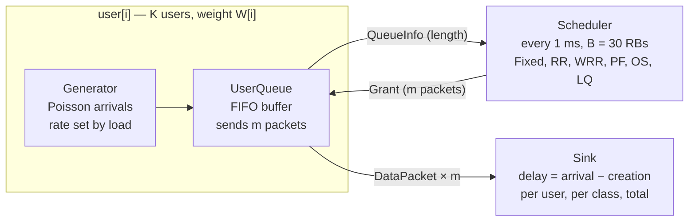

# LTE DL MAC Scheduler in OMNeT++ — Implementation Plan & How-To

Team: Ionut and Alexandru · 3-week plan

**Contents**

1. [Project overview](#1-project-overview)
2. [Team roles and how we work](#2-team-roles-and-how-we-work)
3. [Week 1: base model, 2 users, Fixed allocation](#3-week-1-base-model-2-users-fixed-allocation)
4. [Week 2: 10 users, all schedulers, load control](#4-week-2-10-users-all-schedulers-load-control)
5. [Week 3: experiments, plots, report](#5-week-3-experiments-plots-report)
6. [Assignment requirements checklist](#6-assignment-requirements-checklist)
7. [How to install OMNeT++ 6.5](#7-how-to-install-omnet-65)
8. [How to build, run and analyse the project](#8-how-to-build-run-and-analyse-the-project)
9. [Pitfalls to avoid](#9-pitfalls-to-avoid)

---

## 1. Project overview

In three weeks we deliver an OMNeT++ 6.x model of an LTE downlink MAC scheduler. It has K users (traffic generator + FIFO buffer), one scheduler that hands out B = 30 resource blocks (RBs) every 1 ms TTI, and a sink that measures packet delay. We implement six schedulers (Fixed, RR, WRR, PF, OS, LQ). For each one we plot mean delay at 30/50/70/90% load and per priority class (HP/MP/LP).



The modules exchange only three messages. That lets Ionut (scheduler) and Alexandru (user side and sink) build in parallel once `messages.msg` is agreed.

### Model parameters

| Parameter | Symbol | Value / range | Where it is set |
| --- | --- | --- | --- |
| Users | K | 2 in week 1, 10 in weeks 2–3 | `**.numUsers` |
| Resource blocks per TTI | B | 30 | `**.scheduler.numRBs` |
| Scheduling cycle (TTI) | TB | 1 ms | `**.scheduler.tti` |
| Packets per RB | n(r) | 1–3, set by link quality (packets stay fixed-length); 1 in week 1 | scheduler, `pktsPerRB()` |
| Network load | ρ | 0.3, 0.5, 0.7, 0.9 | `${load=…}` in omnetpp.ini |
| Arrivals per user | λ | Poisson, mean interarrival K·TB / (ρ·B·n̄), n̄ = 2 | `**.gen.sendIaTime` |
| Weights | W[i] | HP = 6 and 8 (2 users), MP = 2 (5 users), LP = 1 (3 users) | `**.user[*].weight` |
| Link quality | r[i] | integer 1–15 (CQI-like), redrawn each TTI per user and RB | scheduler |
| Sim time / warm-up / seeds | — | 20 s / 1 s / 5 repetitions | omnetpp.ini |

Load is offered traffic divided by capacity. A won RB carries n(r) = 1–3 packets, 2 on average when quality is uniform. So the nominal capacity is B·n̄ = 60 packets per TTI (60 000 packets/s):

$$
\rho = \frac{\sum_i \lambda_i}{B \cdot \bar{n} / T_B} \quad\Rightarrow\quad \bar{t}_{ia} = \frac{K \cdot T_B}{\rho \cdot B \cdot \bar{n}}
$$

Example: K = 10 and ρ = 0.5 give a mean interarrival time of 10 × 1 ms / (0.5 × 30 × 2) = 0.333 ms per user. OS and PF pick RBs with good quality, so they can carry more than this nominal capacity. That gain is one of the things the plots should show.

### What happens in one TTI

1. Each generator creates a `DataPacket` (creation time is stamped automatically) and sends it to its queue.
2. The queue stores the packet and sends a `QueueInfo` (its current length) to the scheduler every time the length changes.
3. The scheduler's self-message fires every TB. It runs the selected algorithm and sends each user a `Grant` with m = number of packets it may send: the sum of n(r) over the RBs it won.
4. The queue sends its first min(m, length) packets to `sink.in[i]`.
5. The sink computes delay = now − creation time, records it per user, per class and for the whole system, then deletes the packet.

### One auction loop for all algorithms

Every algorithm except Fixed uses the same loop; only the priority p[i] and the per-user cap change. The second pass keeps the scheduler work-conserving, as the assignment requires: allocation stops only when the RBs run out or all queues are empty.

```cpp
// called once per TTI
alloc.assign(K, 0); rbs.assign(K, 0); int usedRBs = 0;   // alloc = packets, rbs = RBs won
for (int pass = 0; pass < 2; pass++) {          // pass 1: with caps, pass 2: leftovers, no caps
    for (int rb = usedRBs; rb < B; rb++) {
        int best = -1; double bestP = -1;
        for (int i = 0; i < K; i++) {
            if (q[i] - alloc[i] <= 0) continue;          // nothing left to send
            if (pass == 0 && rbs[i] >= cap(i)) continue;     // caps count RBs
            double p = priority(i, rb);                  // depends on the algorithm
            if (p > bestP) { bestP = p; best = i; }      // ties: lowest index wins
        }
        if (best < 0) break;                             // no candidate in this pass
        alloc[best] += pktsPerRB(r[best][rb]); rbs[best]++; usedRBs++;
    }
}
for (int i = 0; i < K; i++) if (alloc[i] > 0) lastServed[i] = simTime();
```

| Algorithm | Priority p[i] | Cap per TTI (pass 1) |
| --- | --- | --- |
| Fixed | not used: every user always gets B/K RBs, unused ones are wasted | B/K = 3 |
| RR (Round Robin) | now − lastServed[i] | common cap, ceil(B/K) = 3 |
| WRR (Weighted RR) | (now − lastServed[i]) · W[i] | W[i] |
| PF (Proportional Fair) | (now − lastServed[i]) · W[i] · r[i][rb] | W[i] |
| OS (Opportunistic) | r[i][rb] | common cap, 3 |
| LQ (Longest Queue) | (q[i] − alloc[i]) · W[i] | none |

The weights sum to 2·8 + 5·2 + 3·1 = 29 (25 with HP = 6), so the WRR and PF caps fit within the 30 RBs.

Packets per RB come from the link quality: `pktsPerRB(r) = (r + 4) / 5` in integer division. So r = 1–5 gives 1 packet, 6–10 gives 2 and 11–15 gives 3. This models better links using a higher-order modulation, which fits more fixed-length packets into one RB. Fixed allocation uses it too: each of its 3 RBs carries n(r) packets for that TTI.

## 2. Team roles and how we work

Ionut owns the scheduler and the experiment configs; Alexandru owns the user side (generator + queue), the sink statistics and the plots. Each of us reviews the other's code, so both can explain the whole model at the presentation.

| Week | Ionut | Alexandru | End-of-week check |
| --- | --- | --- | --- |
| Week 1 (days 1–7): base model | Repo, network NED; Scheduler + Fixed allocation | Generator, UserQueue; User module, Sink stats | 2 users run end to end |
| Week 2 (days 8–14): all schedulers | Auction loop, r[i][rb]; RR, WRR, PF, OS, LQ | 10 users, load, weights; class stats, CSV export | Model frozen |
| Week 3 (days 15–21): experiments | LoadSweep + Weights runs; results discussion | Plots 1 and 2; model chapter of the report | Submit |

Each week ends with a check we run together (sections 3–5). A week only counts as done when its check passes.

| Area | Owner | Reviewer |
| --- | --- | --- |
| Scheduler module, `Grant` / `QueueInfo` handling, all six algorithms, channel quality r[i] | Ionut | Alexandru |
| Network topology (`LteNetwork.ned`), omnetpp.ini configs and parameter studies | Ionut | Alexandru |
| Generator, user queue, `User` compound module, load and weight parameters | Alexandru | Ionut |
| Sink and statistics (per user, per class, whole system) | Alexandru | Ionut |
| Result export and plots (IDE Analysis Tool or Python) | Alexandru | Ionut |
| Report and slides | Both: each writes the parts they built | — |

### Working rules

- **Same version on both laptops:** OMNeT++ 6.5.0 (latest stable, released 29 Oct 2026). Mixed versions cause build and .anf file problems.
- **One GitHub repo** (this one), both as collaborators. `main` must always build. Work on branches (`ionut/scheduler-rr`, `alex/sink-stats`) and merge through a pull request the other person reviews.
- **.gitignore:** `out/`, `results/`, `*_m.cc`, `*_m.h`, `*.exe`, `*.vec`, `*.sca`, `*.vci`. Generated files and results are rebuilt, never committed.
- **Interfaces first:** on day 1 we agree `messages.msg` and the gate names (section 8). After that each person can work alone, because the modules only meet through those messages.
- **Syncs:** 30 minutes twice a week (suggested Monday and Thursday), plus an end-of-week demo where we run the model together and tick off the week's checks.

## 3. Week 1: base model, 2 users, Fixed allocation

By the end of week 1, two identical users send packets through the scheduler to the sink with Fixed allocation (15 + 15 RBs, 1 packet per RB), and the sink reports the mean, min and max delay.

### Both

- [ ] Install OMNeT++ 6.5.0 (section 7) and run `samples/aloha` and `samples/fifo` (day 1)
- [ ] Do TicToc tutorial parts 1–4 to learn NED, `handleMessage`, `scheduleAt` and Qtenv (about 2 h)
- [ ] Agree `messages.msg` (`DataPacket`, `Grant`, `QueueInfo`) and all gate names; commit them first

### Ionut

- [x] Create the GitHub repo
- [ ] Create an empty OMNeT++ project `lte_sched` (with `src/` and `simulations/` folders) plus the `.gitignore`
- [ ] Write `LteNetwork.ned`: `user[numUsers]`, `scheduler`, `sink` and the `for` loop connections
- [ ] Write the `Scheduler` skeleton: TTI self-message, q[i] table updated from `QueueInfo`, sending a `Grant` to every user
- [ ] Implement Fixed allocation (B/K RBs per user, unused RBs wasted)
- [ ] Write `omnetpp.ini` with `[Config Fixed2Users]` at 50% load

### Alexandru

- [ ] Build `Generator` from the fifo `Source`: exponential interarrival `sendIaTime`, sets `userId` and `seqNo`
- [ ] Build `UserQueue` from the fifo queue: `cQueue` buffer, sends a `QueueInfo` on every change, sends min(m, length) packets when a `Grant` arrives
- [ ] Write the `User` compound module (gen → queue) with the `weight` parameter (default 1)
- [ ] Build `Sink`: a `delay` signal with `@statistic`, one `cStdDev` per user, `record()` in `finish()`, packets created before the warm-up are ignored

### End-of-week check (together)

- [ ] At K = 2, ρ = 0.5 the packets received are within 1% of the packets generated
- [ ] Mean delay is above 0 and similar across 3 seeds
- [ ] The Qtenv animation shows grants going out every 1 ms and packets reaching the sink

## 4. Week 2: 10 users, all schedulers, load control

By the end of week 2, the model runs with K = 10 users. All six algorithms can be picked with one ini parameter (`**.scheduler.algorithm`), and the load can be set to any value from 0.3 to 0.9.

### Ionut

- [ ] Refactor the scheduler: string parameter `algorithm` ("FIXED", "RR", "WRR", "PF", "OS", "LQ") selects a `priority(i, rb)` and a `cap(i)` function
- [ ] Implement the auction loop: pass 1 with caps, pass 2 for leftover RBs, `lastServed[i]` update (section 1)
- [ ] Add the channel quality model: r[i][rb] = `intuniform(1, 15)`, redrawn every TTI, plus `pktsPerRB(r)` so a won RB carries 1–3 packets
- [ ] Implement RR and WRR, then check with 2 users that RBs alternate as expected
- [ ] Implement PF, OS and LQ
- [ ] Add scheduler statistics: RBs used per TTI (`rbUsed` signal) and RBs per user

### Alexandru

- [ ] Switch to `user[numUsers]` with K = 10. Read each user's `weight` from omnetpp.ini and give it a class label (HP / MP / LP)
- [ ] Make the generator's interarrival depend on the load: `exponential(K * 1ms / (load * 30 * 2))`
- [ ] Extend the sink: delay per class (HP, MP, LP) and for the whole system, plus the packet count
- [ ] Add queue-length statistics to `UserQueue` (`qlen` signal, mean and max)
- [ ] Sanity tests: the throughput the sink measures matches the offered load. Fixed at ρ = 0.9 stays stable over 20 s
- [ ] Write the export script (`opp_scavetool` → CSV → pandas) and make the first plot: Fixed, delay vs load

### End-of-week check (together)

- [ ] All six algorithms run 20 s in Cmdenv without errors or memory warnings
- [ ] Delay grows with load for every algorithm, and Fixed is the worst at 90%
- [ ] Each of us has reviewed and merged the other's pull requests; the model is frozen except for bug fixes

## 5. Week 3: experiments, plots, report

Week 3 produces the two required comparisons, with 95% confidence intervals from 5 seeds. The first is mean delay vs load for every algorithm. The second is mean delay per priority class with weights. The last two days are for the presentation dry run and packaging the submission.

### Ionut

- [ ] `[Config LoadSweep]`: 6 algorithms × 4 loads × 5 seeds = 120 runs, all users W = 1
- [ ] `[Config Weights]`: 2 HP (W = 6 and W = 8, as an iteration variable), 5 MP (W = 2), 3 LP (W = 1), loads 0.5 / 0.7 / 0.9, the five weighted algorithms
- [ ] Run both studies in parallel with `opp_runall`. If a 90%-load confidence interval is wider than 10% of its mean, use a longer `sim-time-limit`
- [ ] Write the results discussion: which algorithm wins at which load, and why HP users get lower delay under WRR / PF / LQ but not under RR / OS

### Alexandru

- [ ] Plot 1: mean delay (ms) vs load (%), one line per algorithm, with error bars
- [ ] Plot 2: mean delay per class (HP / MP / LP), grouped by algorithm, one panel per load, for HP W = 6 and W = 8 side by side
- [ ] Optional plot 3: RB utilisation or Jain's fairness index vs load
- [ ] Write the model chapter of the report: modules, messages and parameters, with a screenshot of the network in Qtenv

### Both

- [ ] Report (8–12 pages): introduction, model, algorithms (section 1 table), simulation setup, results, conclusions
- [ ] Slides (8–10) plus a live Qtenv demo with 10 users and the PF scheduler
- [ ] Final package: source code zip (no `out/` or `results/`), a README with build and run commands, report PDF, slides
- [ ] Dry run of the presentation; each of us presents the part they built

## 6. Assignment requirements checklist

Every requirement in the assignment maps to a task above. Use this table before submitting.

| Requirement from the assignment | Covered by | Week |
| --- | --- | --- |
| Two identical users, then K users as an array | `Fixed2Users` config, then `user[numUsers]` | 1 → 2 |
| Scheduler: B = 30 RBs every TB = 1 ms, reads queue lengths, tells each user how many blocks to send | `Scheduler` + `QueueInfo` / `Grant` | 1 |
| Sink deletes packets and collects per-user and system statistics (count, mean / min / max delay) | `Sink` with `cStdDev` per user + `delay` signal | 1–2 |
| User = generator + FIFO buffer; the first m packets are sent when granted | `User` = `Generator` → `UserQueue` | 1 |
| Start from the fifo sample | Generator, queue and sink adapted from `samples/fifo` | 1 |
| Fixed channel allocation | `algorithm = "FIXED"` | 1 |
| Work-conserving schedulers (stop when RBs or data run out) | auction loop with a second pass | 2 |
| Auction with p[i]: OS, RR, WRR, PF, LQ; RBs capped by W[i] or a common cap | `priority()` / `cap()` per algorithm | 2 |
| Mean delay vs load at 30 / 50 / 70 / 90% for each algorithm | `LoadSweep` + Plot 1 | 3 |
| Different weights: HP W = 6 or 8, MP W = 2, LP W = 1 | `Weights` + Plot 2 | 3 |

## 7. How to install OMNeT++ 6.5

Install OMNeT++ 6.5.0, the latest stable release ([omnetpp.org](https://omnetpp.org/), released 29 Oct 2026). On Windows, everything runs inside the bundled MinGW shell. Expect 30–60 minutes, most of it compiling. The steps follow the official [Installation Guide](https://doc.omnetpp.org/omnetpp/InstallGuide.pdf). The online guide is still the 6.1 edition, but the steps are the same for 6.x.

### Windows 10/11 (64-bit)

1. Download the **Windows** archive from [omnetpp.org/download](https://omnetpp.org/download): `omnetpp-6.5.0-windows-x86_64.zip`.
2. Extract it to a path **with no spaces**, e.g. `C:\omnetpp-6.5.0`. Do not use Program Files, or a Desktop / OneDrive folder whose path has spaces.
3. Double-click `mingwenv.cmd` in that folder. A bash shell opens with OMNeT++ on the PATH. The first start pauses while the `tools` folder is unpacked.
4. In that shell, build everything (add `-j8` to use 8 cores):

   ```bash
   ./configure
   make -j8
   ```

5. Test it. The Qtenv window should open:

   ```bash
   cd samples/aloha
   ./aloha
   ```

6. Start the IDE from the same shell with `omnetpp`. When it asks for a workspace, pick a folder with no spaces, e.g. `C:\omnetpp-6.5.0\workspace`.
7. Always start the IDE and simulations from `mingwenv.cmd`, so the environment variables are set. You can also make a desktop shortcut to `ide\opp_ide.exe`.

Optional: add the OMNeT++ folder to the Windows Defender exclusions. Antivirus scanning can make compiling several times slower.

### Linux (Ubuntu 22.04 / 24.04)

```bash
# 1. prerequisites
sudo apt-get update
sudo apt-get install build-essential clang lld gdb bison flex perl \
  python3 python3-pip python3-venv libpython3-dev qtbase5-dev qtchooser qt5-qmake \
  qtbase5-dev-tools libqt5opengl5-dev libxml2-dev zlib1g-dev doxygen \
  graphviz libwebkit2gtk-4.1-0 xdg-utils libdw-dev

# 2. unpack the Linux archive downloaded from omnetpp.org/download
cd ~ && tar xvfz omnetpp-6.5.0-linux-x86_64.tgz && cd omnetpp-6.5.0

# 3. Python environment for the analysis tools
python3 -m venv .venv && source .venv/bin/activate
python3 -m pip install -r python/requirements.txt

# 4. environment, configure, build
source setenv
./configure
make -j$(nproc)

# 5. test, then start the IDE
cd samples/aloha && ./aloha
omnetpp
```

To make the environment permanent, add `source $HOME/omnetpp-6.5.0/setenv` to `~/.profile`.

### Learn the basics first (about 2 hours)

Do parts 1–4 of the TicToc tutorial (Help → Tutorials in the IDE, or `doc/tictoc-tutorial`). It teaches the four things this project uses: NED modules and gates, `handleMessage()`, self-messages with `scheduleAt()`, and recording statistics. Then open `samples/fifo` and run it. Its Source → Fifo → Sink chain is the starting point for one user.

## 8. How to build, run and analyse the project

Create an empty project in the IDE and copy the fifo sample's source, queue and sink into it. Then add the files below and run the studies from the command line. Analyse the results in the IDE or in Python.

### Create the project

1. IDE: **File → New → OMNeT++ Project**, name `lte_sched`, template **Empty project with 'src' and 'simulations' folders**.
2. From `samples/fifo`, copy the source, the queue (abstract FIFO + FIFO), the sink and the `.msg` file into `lte_sched/src/`. Rename the classes to `Generator`, `UserQueue` and `Sink`, and fix each `Define_Module(...)`.
3. Build with **Project → Build Project** (Ctrl+B). The IDE writes the Makefile and runs `opp_msgc` on `.msg` files for you.

### File layout

```text
lte_sched/
  src/
    messages.msg          DataPacket, Grant, QueueInfo
    Generator.ned/.h/.cc
    UserQueue.ned/.h/.cc
    User.ned              compound module: gen -> queue
    Scheduler.ned/.h/.cc
    Sink.ned/.h/.cc
    LteNetwork.ned
  simulations/
    omnetpp.ini
  analysis/
    plots.py
```

### Messages and NED

```cpp
// messages.msg
packet DataPacket { int userId; long seqNo; }
message Grant     { int numRBs; int numPackets; }
message QueueInfo { int userId; int length; }
```

```ned
simple Generator {
    parameters:
        volatile double sendIaTime @unit(s);   // re-drawn on every read
    gates:
        output out;
}

simple UserQueue {
    parameters:
        @signal[qlen](type=long);
        @statistic[qlen](record=timeavg,max,vector);
    gates:
        input in; input grantIn;
        output out; output infoOut;
}

module User {
    parameters:
        double weight = default(1);
        @display("i=device/cellphone");
    gates:
        input grantIn; output infoOut; output dataOut;
    submodules:
        gen: Generator;
        queue: UserQueue;
    connections:
        gen.out --> queue.in;
        grantIn --> queue.grantIn;
        queue.infoOut --> infoOut;
        queue.out --> dataOut;
}

simple Scheduler {
    parameters:
        int numRBs = default(30);
        double tti @unit(s) = default(1ms);
        string algorithm = default("FIXED");
        bool useQuality = default(true);      // false: always 1 packet per RB
        int commonCap = default(3);
        @signal[rbUsed](type=long);
        @statistic[rbUsed](record=mean,vector);
    gates:
        input infoIn[]; output grantOut[];
}

simple Sink {
    parameters:
        @signal[delay](type=simtime_t);
        @statistic[delay](unit=s; record=count,mean,min,max,histogram);
    gates:
        input in[];
}

network LteNetwork {
    parameters:
        int numUsers = default(10);
    submodules:
        user[numUsers]: User;
        scheduler: Scheduler { gates: infoIn[numUsers]; grantOut[numUsers]; }
        sink: Sink { gates: in[numUsers]; }
    connections:
        for i=0..numUsers-1 {
            scheduler.grantOut[i] --> user[i].grantIn;
            user[i].infoOut --> scheduler.infoIn[i];
            user[i].dataOut --> sink.in[i];
        }
}
```

### Key C++ parts

```cpp
// UserQueue: store packets, report length, send m packets on a Grant
void UserQueue::handleMessage(cMessage *msg) {
    if (msg->arrivedOn("in")) {
        queue.insert(msg);
        reportLength();
    } else {
        auto grant = check_and_cast<Grant *>(msg);
        int m = std::min(grant->getNumPackets(), queue.getLength());
        for (int k = 0; k < m; k++)
            send(check_and_cast<cMessage *>(queue.pop()), "out");
        delete grant;
        if (m > 0) reportLength();
    }
}
void UserQueue::reportLength() {
    emit(qlenSignal, queue.getLength());
    auto info = new QueueInfo("qinfo");
    info->setUserId(getParentModule()->getIndex());
    info->setLength(queue.getLength());
    send(info, "infoOut");
}

// Scheduler: one tick per TTI
void Scheduler::handleMessage(cMessage *msg) {
    if (msg == tick) {
        drawChannelQuality();          // r[i][rb] = intuniform(1, 15)
        runScheduling();               // Fixed, or the auction loop from section 1
        for (int i = 0; i < K; i++) {
            auto g = new Grant("grant");
            g->setNumRBs(rbs[i]);
            g->setNumPackets(alloc[i]);
            send(g, "grantOut", i);
        }
        scheduleAt(simTime() + tti, tick);
    } else {
        auto info = check_and_cast<QueueInfo *>(msg);
        q[info->getUserId()] = info->getLength();
        delete info;
    }
}
double Scheduler::priority(int i, int rb) {
    double wait = (simTime() - lastServed[i]).dbl();
    if (algo == "RR")  return wait;
    if (algo == "WRR") return wait * weight[i];
    if (algo == "PF")  return wait * weight[i] * r[i][rb];
    if (algo == "OS")  return r[i][rb];
    if (algo == "LQ")  return (q[i] - alloc[i]) * weight[i];
    throw cRuntimeError("Unknown algorithm %s", algo.c_str());
}

// Sink: delay per user, only for packets created after the warm-up
void Sink::handleMessage(cMessage *msg) {
    auto pkt = check_and_cast<DataPacket *>(msg);
    if (pkt->getCreationTime() >= getSimulation()->getWarmupPeriod()) {
        simtime_t d = simTime() - pkt->getCreationTime();
        emit(delaySignal, d);
        perUser[pkt->getUserId()].collect(d);   // cStdDev named "delayUser<i>"
    }
    delete pkt;
}
void Sink::finish() {
    for (auto &s : perUser) s.record();         // writes count, mean, min, max, stddev
}
```

The scheduler reads each user's weight in `initialize()` with `getParentModule()->getSubmodule("user", i)->par("weight")`. The sink uses the same call to put each user into HP / MP / LP.

### omnetpp.ini

```ini
[General]
network = LteNetwork
sim-time-limit = 20s
warmup-period = 1s
repeat = 5
seed-set = ${repetition}
**.vector-recording = false        # keep result files small during sweeps
**.numUsers = 10

[Config Fixed2Users]
**.numUsers = 2
**.scheduler.algorithm = "FIXED"
**.scheduler.useQuality = false   # week 1: 1 packet per RB
**.user[*].gen.sendIaTime = exponential(2 * 1ms / (0.5 * 30))

[Config LoadSweep]
**.scheduler.algorithm = ${algo="FIXED","RR","WRR","PF","OS","LQ"}
**.user[*].gen.sendIaTime = exponential(10 * 1ms / (${load=0.3,0.5,0.7,0.9} * 30 * 2))

[Config Weights]
**.scheduler.algorithm = ${algo="RR","WRR","PF","OS","LQ"}
**.user[*].gen.sendIaTime = exponential(10 * 1ms / (${load=0.5,0.7,0.9} * 30 * 2))
**.user[0..1].weight = ${hpW=6,8}   # HP: runs both values
**.user[2..6].weight = 2           # MP
**.user[7..9].weight = 1           # LP
```

### Run

- **GUI (debugging, demo):** open `simulations/omnetpp.ini` in the IDE and click **Run**. Pick a config in Qtenv, then use Step, Run or Fast. Double-click a module to inspect its queue or variables.
- **Batch (experiments):** from the `mingwenv` shell, in `simulations/`. The IDE builds the executable as `lte_sched`; check whether it lands in `src/` or the project root and adjust the path.

```bash
../src/lte_sched -c LoadSweep -q numruns                          # how many runs: 120
opp_runall -j4 ../src/lte_sched -u Cmdenv -c LoadSweep -n ../src:.
opp_runall -j4 ../src/lte_sched -u Cmdenv -c Weights   -n ../src:.
```

Results land in `simulations/results/` as `.sca` (scalars) and `.vec` (vectors).

### Analyse and plot

- **IDE Analysis Tool:** double-click any `.sca` file to create an `.anf` analysis file. In **Browse Data**, filter on `name =~ "delay:mean"`, select the rows and plot them. Put the `load` iteration variable on the X axis, with one series per `algo`. Charts can be exported as PNG/SVG for the report.
- **Python (more control):** export to CSV, then group with pandas.

```bash
opp_scavetool export -F CSV-R -o loadsweep.csv results/LoadSweep-*.sca
```

```python
import pandas as pd, matplotlib.pyplot as plt
df = pd.read_csv("loadsweep.csv")            # check df.head(): columns run, type, module, name, attrname, attrvalue, value
itv = df[df.type == "itervar"].pivot(index="run", columns="attrname", values="attrvalue")
sc = df[(df.type == "scalar") & (df.name == "delay:mean")].set_index("run")[["value"]]
d = sc.join(itv)
d["load"] = d["load"].astype(float) * 100
d["algo"] = d["algo"].str.strip('"')
agg = d.groupby(["algo", "load"])["value"].agg(["mean", "sem"]) * 1000   # seconds -> ms
for algo, g in agg.groupby(level=0):
    g = g.droplevel(0)
    plt.errorbar(g.index, g["mean"], yerr=1.96 * g["sem"], marker="o", capsize=3, label=algo)
plt.xlabel("Network load (%)"); plt.ylabel("Mean packet delay (ms)"); plt.legend(); plt.grid(alpha=.3)
plt.savefig("delay_vs_load.png", dpi=200)
```

## 9. Pitfalls to avoid

Most lost hours in OMNeT++ projects come from the same few mistakes:

- **Spaces in paths** break the Windows build. Keep OMNeT++, the workspace and the repo in paths like `C:\omnetpp-6.5.0\workspace\lte_sched`.
- **Starting the IDE outside `mingwenv.cmd`** gives "make not found" or missing-DLL errors.
- **Message ownership:** after `send()` the message belongs to the simulation, so never touch it again. Delete every `Grant` and `QueueInfo` you receive. Call `cancelAndDelete(tick)` in the destructor, or Cmdenv reports undisposed objects.
- **Warm-up only applies to signals.** `@statistic` results skip the warm-up automatically, but a hand-filled `cStdDev` does not. That is why the sink checks the creation time.
- **Simultaneous events:** a packet arrival and the TTI tick can fall at the same time. The model must not depend on their order. The queue never sends more than it holds, so a stale q[i] only wastes an RB for one TTI.
- **Fixed allocation and K:** B / K must be a whole number (30 / 10 = 3, 30 / 2 = 15). Otherwise round down, and say in the report what happens to the leftover RBs.
- **Overload looks like slowly rising delay.** If mean delay keeps growing with `sim-time-limit`, that user or system is unstable at that load. This is a valid finding (e.g. Fixed at high load with unequal traffic), but say so explicitly rather than reporting a single number.
- **Result file size:** keep `**.vector-recording = false` for the sweeps. Turn vectors on only for the one run you use for a delay-over-time figure.
- **Same seeds for every algorithm:** `seed-set = ${repetition}` gives every algorithm the same 5 traffic patterns. This makes the comparison fairer and the confidence intervals tighter.
