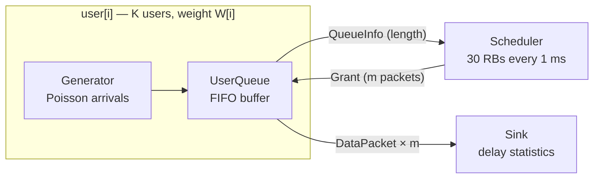

# lte-dl-scheduler-omnetpp

OMNeT++ simulation of LTE downlink MAC scheduling. It compares six schedulers (Fixed, Round Robin, Weighted RR, Proportional Fair, Opportunistic, Longest Queue) on packet delay as network load grows and across users with different priorities.

Course project at the Polytechnic University of Timișoara (UPT), by Ionut and Alexandru.

> **Status:** in development. See the [implementation plan](docs/IMPLEMENTATION_PLAN.md) for the 3-week schedule, design details and the install guide.

## The model



- **Users:** each one is a generator (Poisson traffic) feeding a FIFO queue. The network has K users (2 for the first tests, 10 for the experiments).
- **Scheduler:** every TTI (1 ms) it shares B = 30 resource blocks (RBs) among the users and tells each user how many packets to send. A won RB carries 1–3 fixed-length packets, depending on the user's link quality for that RB (CQI-like value 1–15, redrawn every TTI).
- **Sink:** receives the packets, deletes them and records delay per user, per priority class and for the whole system: count, mean, min and max.

### Scheduling algorithms

All except Fixed use the same per-RB auction: the user with the highest priority p[i] wins the RB. A second pass hands out leftover RBs, so no RB is wasted while there is data waiting.

| Algorithm | Priority p[i] |
| --- | --- |
| Fixed | none: every user always gets B/K RBs |
| Round Robin (RR) | time since the user was last served |
| Weighted RR (WRR) | time since last served × W[i] |
| Proportional Fair (PF) | time since last served × W[i] × link quality |
| Opportunistic (OS) | link quality |
| Longest Queue (LQ) | queue length × W[i] |

### Experiments

1. **Mean delay vs network load** (30, 50, 70, 90%) for every algorithm.
2. **Mean delay per priority class with weights:** 2 high-priority users (W = 6 and W = 8), 5 medium (W = 2), 3 low (W = 1).

Each point is the mean of 5 independent runs with a 95% confidence interval.

## Repository layout

```text
lte_sched/              OMNeT++ project (import this folder into the IDE)
  src/                  NED modules, C++ code, messages.msg
  simulations/          omnetpp.ini with the Fixed2Users, LoadSweep and Weights configs
analysis/               result export and plotting scripts (Python)
docs/                   implementation plan and report material
```

The folders are created during week 1. See [section 8 of the plan](docs/IMPLEMENTATION_PLAN.md#8-how-to-build-run-and-analyse-the-project).

## Getting started

**Requirements:** OMNeT++ 6.5.0 (Windows, Linux or macOS). Python 3 with pandas and matplotlib is needed only for the plots. Install steps are in [section 7 of the plan](docs/IMPLEMENTATION_PLAN.md#7-how-to-install-omnet-65).

1. Clone the repo into a path **without spaces**:

   ```bash
   git clone https://github.com/ionutT77/lte-dl-scheduler-omnetpp.git
   ```

2. Start the OMNeT++ IDE (on Windows, from `mingwenv.cmd`). Then use **File → Import → General → Existing Projects into Workspace** and select the cloned folder.
3. Build with **Project → Build Project** (Ctrl+B).
4. Open `lte_sched/simulations/omnetpp.ini` and click **Run**. Pick a config in Qtenv to watch the simulation.

### Running the experiments (command line)

From the OMNeT++ shell, inside `lte_sched/simulations/`:

```bash
opp_runall -j4 ../src/lte_sched -u Cmdenv -c LoadSweep -n ../src:.
opp_runall -j4 ../src/lte_sched -u Cmdenv -c Weights   -n ../src:.
```

Results are written to `lte_sched/simulations/results/`. They are not committed; re-run the configs to regenerate them.

## Team

| Member | Responsible for |
| --- | --- |
| Ionut | Scheduler and all algorithms, network topology, experiment configs |
| Alexandru | Generator and queue, sink statistics, result export and plots |

## Workflow

- `main` always builds. Work happens on branches (`ionut/...`, `alex/...`) and is merged through a pull request reviewed by the other member.
- Generated files are not committed: `out/`, `results/`, `*_m.cc`, `*_m.h`, `*.exe`, `*.sca`, `*.vec`, `*.vci`.
